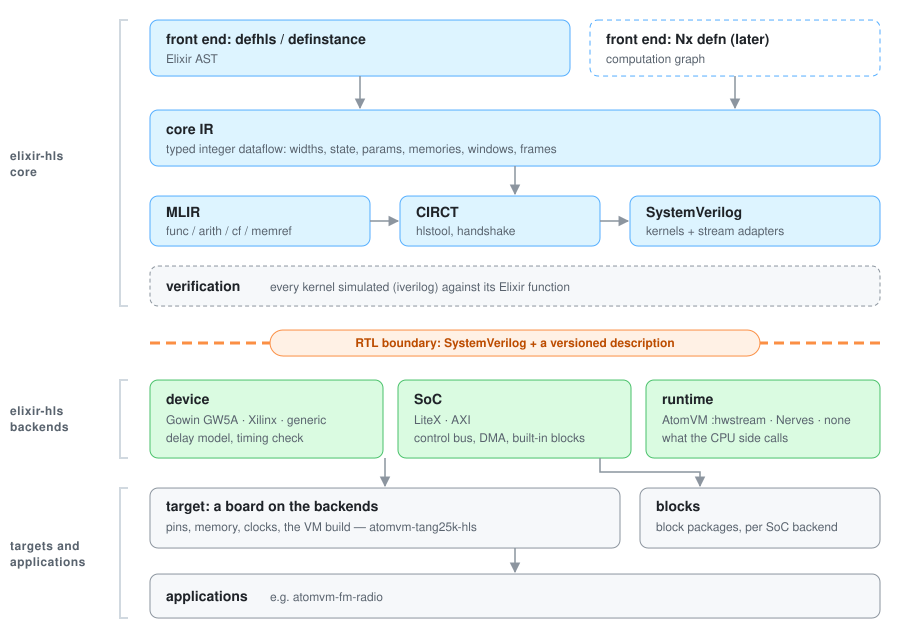

# Elixir HLS — 構想

[English](vision.md) | 日本語

## なぜ作るのか

FPGA を使うシステムでは、同じものを何度も書くことになりがちです。CPU 側の処理は C や
Elixir で、FPGA の回路は Verilog で書き、両方が何をすべきかは別の文書にまとめます。そして、
それらが食い違わないように、人の手で合わせ続けます。

Elixir HLS では、CPU 側も FPGA 側も含めたシステム全体を、Elixir だけで書きます。その記述が、
そのまま仕様になります。しかも、この仕様は実行できます。システムが何をすべきかが、動く
コードとして、あいまいさなく決まります。

Elixir が FPGA 側の記述に向いているのは、関数型の言語だからです。共有された状態を書き換えない
純粋な関数は、そのまま回路として表せます。式は論理回路になり、状態は明示的に書きます
（`{出力, 次の状態}` を返す関数の状態は、レジスタになります）。`|>` でつないで
配置した関数は、データが流れていく回路になります。そのため、1 つの言語で、アプリケーションの
段階（ハードウェアを調整し、見守るプロセス）から、論理回路の段階（`s18` のような
ビット幅、テーブル、メモリ、フィルタがクロックごとに持つ状態）まで書けます。

ハードウェアにする作業は、自動にします。それぞれの回路は Elixir の関数から作り、ランタイムと
一緒に SoC に組み込み、元の関数とシミュレーションで照合します。元になるのは常に仕様だけで、
ハードウェアは、そこから作られるものです。

AI エージェントがコードを書いたり直したりする機会が増えるほど、このことは重要になります。
実行できる仕様が 1 つの言語で 1 つだけあれば、エージェントは、全体を読み、1 か所を直し、
動かして確かめることができます。手で書いた何種類もの記述を、食い違わないように保つ必要は
ありません。ハードウェアが仕様どおりであることは、自動の変換と照合が保証します。

## 何か

Elixir の高位合成です。一度書いた関数が、CPU では Elixir として、FPGA では回路として動きます。
どの回路も、元の Elixir の関数とシミュレーションで照合します。ストリームのインスタンス
（`definstance`）は、FPGA の中で自律して動きます。FPGA の隣の VM で動くプログラムは、それを
調整し、見守るか、関数として呼ぶだけです。LED やスイッチのように今の値だけがあるピンは、普通の関数呼び出しで
読み書きし、ボタンが押されたことのように欠けると困るものは、メッセージとして受け取ります。

今は、FM ラジオを例題として、その処理に必要なところまで合成できます。より一般的な処理に
必要な表現力は、これから足していきます。

最初のターゲットは、Sipeed Tang Primer 25K です。FPGA の中に LiteX で SoC を作り、その CPU
（ソフト CPU）で AtomVM を動かします。プログラムとその回路が、1 つのチップに収まります。

## 層の構成

本体は、ボードも、FPGA のメーカーも、SoC も、VM も知りません。本体が出すのは、RTL と、
その説明だけです。ハードウェアに依存する部分は、デバイス、SoC、ランタイムの 3 種類の
バックエンドにまとめます。ターゲットは、それらの組み合わせの上に、ボードを載せたものです
（[設計](design.ja.md)）。

回路を作る部分には、当面 CIRCT を使います。Elixir を MLIR の標準的な方言に訳し、それを
CIRCT が回路にします。この方法で、どこまでの処理を表せるのか、どれくらいの大きさと速さの
回路ができるのかを確かめることも、この取り組みの一部です。

## リポジトリ

Organization `elixir-hls` に、本体の elixir-hls、ターゲット（土台と、その上の HLS の層。例:
`atomvm-tang25k` と `atomvm-tang25k-hls`）、ブロックのパッケージ、アプリケーションを
置きます。

## 予定

* Nerves: FPGA の隣にある組み込み Linux の上で、BEAM（Erlang / Elixir の VM）をそのまま動かす、
  もう 1 種類のターゲット。
* Nx: Nx の `defn` を、`defhls` / `definstance` と並ぶ 2 つ目のフロントエンドとして、同じ
  中間表現に入れる。
